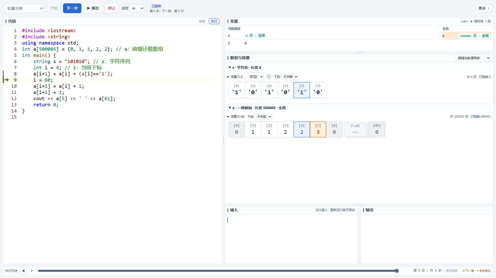

# 代码实验台 · C++ Step Lab

**让 C++ 的每一步执行都看得见。**

代码实验台是一款面向课堂演示与基础算法教学的本机工具。它将代码、变量、数组和输入输出放在同一页面，基于真实 GCC/GDB 单步执行，帮助学生理解程序如何运行、数据如何变化。

适用于 **Windows x64**，支持 **C++11 / C++14 单文件程序**。网页使用本地资源，环境准备完成后可离线运行。当前项目版本为 1.0.0。



上图展示 `a[i+1] = a[i] + (s[i]=='1');` 执行后的状态：`a[i]` 和 `s[i]` 以蓝色标出，写入目标 `a[i+1]` 以橙色标出。黄色代码箭头表示**下一条待执行语句**。

## 可以用它做什么

- **逐步讲解执行过程**：下一步、进入函数、跳过函数，以及可调速度的播放与暂停。
- **观察变量与调用帧**：显示局部变量、全局变量、前后值变化和递归调用中的独立状态。
- **看清数组读写位置**：读取格子用蓝色强调，写入格子用橙色强调；写入相同数值也会标记目标。
- **展示数组与容器**：支持一维、二维数组、`vector` 和 `string`，字符串可切换字符与编码显示。
- **聚焦大数组中的有效信息**：按窗口读取元素，折叠连续相同值；本步读写位置保持展开，并自动定位到可见区域。
- **回看执行历史**：代码位置、变量、读写标记和输入输出同步还原，方便复盘。
- **准备和复用课例**：内置变量交换、数组求和、前缀和、二维遍历、容器与递归等课例，也可保存和载入自己的 JSON 课例。
- **适配课堂投影**：拖动分隔线调整区域比例，支持代码配色与减少动效设置。

## 快速开始：从源码运行

Git 仓库不包含 Python、GCC/GDB、虚拟环境或离线二进制包。首次运行需要先准备下面的环境。

### 1. 准备环境

- Windows x64。
- Python 3.10 或以上，推荐 Python 3.14。
- 带 Python 支持的 GCC/GDB 工具链，推荐 MSYS2 UCRT64。
- 浏览器，推荐本机 Microsoft Edge。

如果使用 MSYS2，在 **UCRT64 终端**安装编译和调试工具：

```sh
pacman -S mingw-w64-ucrt-x86_64-gcc mingw-w64-ucrt-x86_64-gdb
```

启动器优先查找项目内的 `runtime/ucrt64`，其次查找 `C:/msys64/ucrt64`，最后检查 PATH。GDB 必须支持内置 Python；安装完整工具链后可用下面的环境检查命令确认。

### 2. 获取项目并安装依赖

在 PowerShell 中执行：

```powershell
git clone https://github.com/Katharr/cpp-step-lab.git
cd cpp-step-lab
python -m venv .venv
& ./.venv/Scripts/python.exe -m pip install -r requirements.txt
```

Python 环境统一放在根目录 `.venv`，依赖版本由 `requirements.txt` 锁定，无需激活虚拟环境。

### 3. 检查并启动

```powershell
.\start.bat --check
.\start.bat
```

也可以直接双击 `start.bat`。启动器会检查环境、启动本机服务并自动打开实验台网页。默认地址为 `http://127.0.0.1:8765/`，请保持启动窗口开启。

端口被占用时执行 `start.bat --port 8766`，按启动窗口给出的地址访问。

### 4. 开始第一节课

1. 选择“数组求和”等课例，确认代码和输入内容。
2. 点击“开始”，再点击“下一步”观察代码位置、变量和数组变化。
3. 使用播放、暂停或底部执行历史进行演示和回看。
4. 需要保留修改时，在“更多”中保存课例。
5. 下课双击 `stop.bat`，或在启动窗口按 Ctrl+C，停止服务并清理所属进程。

课堂运行不需要 Node.js；源码安装完成后，日常启动无需联网。如果已有完整便携包，完整解压后双击包内的 `start.bat` 即可使用。便携包的构建方式见下文。

## 使用说明与边界

| 需要了解 | 说明 |
| --- | --- |
| 代码位置 | 黄色箭头表示下一条待执行语句；变量和数组显示已经执行的状态。 |
| 数组高亮 | 蓝色表示本步读取，橙色表示本步写入；历史回看还原当步标记。 |
| 重复值折叠 | 叠片 `⋯` 格子可点击展开、再次点击收起；只折叠当前窗口内已读取的确定值。 |
| 大数组 | 默认读取 50 个元素，窗口最多 200 个；不会一次读取整个大数组。 |
| 未初始化值 | “待确认”和“未赋值”会明确标出，不能当成 0。 |
| 标准输入 | 开始前一次性填写全部输入，暂不支持运行中追加交互输入。 |
| 复杂表达式 | 函数调用、条件路径或副作用等无法可靠确认时，不推测格子读写。 |
| 运行范围 | 目前面向 Windows x64 上的 C++11/14 单文件教学程序，不是完整 IDE。 |

服务只监听本机，但**不是隔离沙箱**，请只运行可信代码。课例和日志中不要存放学生、家长的真实姓名、电话、账号等身份信息。

- [老师使用说明](docs/代码实验台-老师使用说明.md)：课堂操作、窗口调整、变量状态与历史回看。
- [故障处理](docs/代码实验台-故障处理.md)：环境、连接、端口占用与异常恢复。
- [开发说明](docs/开发说明.md)：模块职责、接口与快照约定、测试和维护入口。
- [项目文档索引](docs/README.md)：当前使用、故障处理、开发和发布说明。

## 开发与验收

网页由 HTML、CSS 和原生 JavaScript 构成，无前端构建步骤。需要修改网页或运行网页验收时，在项目根目录安装本项目锁定的测试依赖：

```powershell
npm ci
```

测试默认使用本机 Edge，不下载浏览器；`CODE_LAB_BROWSER` 可指定其他 Chromium 浏览器的可执行文件路径。

运行真实 GCC/GDB、调试会话、数组结构和 HTTP 接口验收：

```powershell
& ./.venv/Scripts/python.exe check.py
```

先用 `start.bat` 启动服务，再在另一个 PowerShell 窗口中运行网页验收：

```powershell
npm run test:browser
npm run test:data
npm run test:layout
npm run test:appearance
npm run test:visual
```

测试完成后运行 `stop.bat`。测试产物、运行日志、临时代码和二进制文件均不提交到 Git。

## 构建离线便携包

构建前需在本项目内准备 `runtime/ucrt64` 和 `wheelhouse`；这些大体积依赖不随 Git 仓库分发。Python 依赖可从准备好的离线 wheel 安装：

```powershell
& ./.venv/Scripts/python.exe -m pip install --no-index --find-links wheelhouse -r requirements.txt
```

停止服务后执行：

```powershell
& ./.venv/Scripts/python.exe build_release.py --output 发布/代码实验台-1.0.0-Windows-x64
# 对已经组装的默认发布目录，仅更新项目代码、文档和校验清单
& ./.venv/Scripts/python.exe build_release.py --refresh
# 验收通过后生成 ZIP 和 SHA-256
& ./.venv/Scripts/python.exe build_release.py --zip-only
```

完整便携包包含 Python、GCC/GDB、离线依赖、课例、文档、第三方原有许可证和逐文件校验清单，可在准备好的 Windows x64 电脑上离线使用。

发布前先关闭源码服务，执行 `& ./.venv/Scripts/python.exe verify_delivery.py` 检查发布包独立运行与清理；随后启动发布目录里的服务，执行 `npm run test:delivery` 完成断网浏览器演练。具体发布约定见 [发布说明](发布/README.md)。

## 项目结构

| 路径 | 用途 |
| --- | --- |
| `web/` | 网页、样式、交互与浏览器验收。 |
| `运行器/` | 编译运行、HTTP 服务与会话接口。 |
| `调试器/` | GDB 会话、变量快照、数组结构与读写位置识别。 |
| `课例/` | 可直接载入的 JSON 教学课例。 |
| `docs/` | 教师说明、故障处理、开发说明与效果图。 |
| `runtime/`、`wheelhouse/`、`发布/` | 本机运行环境与便携包产物，大体积内容由 Git 忽略。 |

所有运行资源、依赖清单与脚本都由本项目管理，路径以脚本所在目录为基准。文档在本仓库维护；第三方代码及依赖保留并遵循各自许可证。
